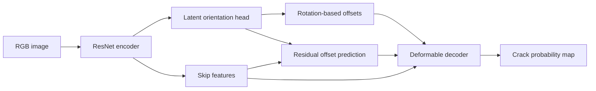

# OGDNet

**Orientation-guided deformable convolution for concrete crack segmentation.**

[](https://github.com/TrungVuManh/OGDNet/actions/workflows/tests.yml)
[](LICENSE)
[](requirements.txt)

PyTorch research code for OGDNet, together with nine comparison model
implementations, component ablations, explicit data splitting, training,
evaluation, and single-image prediction.

**Release scope:** model definitions come from the research project. The public
training and data tools have been cleaned up and tested separately. Historical
checkpoints and exact manuscript split manifests are not included; running this
repository is not a guarantee of reproducing the reported numbers. See
[reproducibility notes](docs/REPRODUCIBILITY.md).

## Method

OGDNet predicts a latent double-angle orientation field from encoder features.
Each decoder block combines rotation-based sampling offsets with bounded learned
residual offsets. Segmentation masks provide the training supervision; no
separate orientation labels are required.



The field is a learned feature, not a calibrated physical orientation estimate.
Double-angle encoding does not remove the scalar `atan2` branch cut or its
zero-vector singularity. See [method notes](docs/REPRODUCIBILITY.md).

## Install

Use Python 3.11. From the repository root:

```bash
git clone https://github.com/TrungVuManh/OGDNet.git
cd OGDNet
python -m venv .venv
```

Activate with `source .venv/bin/activate` on Linux/macOS or
`.\.venv\Scripts\Activate.ps1` in Windows PowerShell.

Choose **one** matching PyTorch/torchvision installation:

```bash
# NVIDIA CUDA 11.8 wheels (requires a compatible NVIDIA driver)
python -m pip install torch==2.7.1 torchvision==0.22.1 --index-url https://download.pytorch.org/whl/cu118

# Or CPU wheels, including for the offline smoke tests
python -m pip install torch==2.7.1 torchvision==0.22.1 --index-url https://download.pytorch.org/whl/cpu
```

Then install the remaining pinned dependencies:

```bash
python -m pip install -r requirements.txt
```

CPU is suitable for functional checks; full training is intended for an NVIDIA
GPU. MPS is not tested. The model needs the compiled `torchvision.ops.deform_conv2d`
operator, so keep torch and torchvision versions matched. Pretrained backbones
are downloaded by timm on first use; `--no-pretrained` allows training from scratch.
The pins describe the public test environment, not a recovered historical lockfile.

## Data and explicit splits

Download the datasets independently; images and weights are not stored in Git:

- [Özgenel Concrete Crack Segmentation Dataset](https://data.mendeley.com/datasets/jwsn7tfbrp/1): 458 image–mask pairs.
- Concrete400: 379 pairs; the manuscript lists DOI `10.5281/zenodo.21193945`.
  Public access to that record has not been independently confirmed for this
  release. See [data preparation](docs/DATA.md).

```text
data/concrete400/
├── Image/                 # RGB PNG/JPEG images
├── Label/                 # matching basenames, binary masks (0/1 or 0/255)
└── split_seed42.json
```

```bash
python scripts/prepare_split.py --data data/concrete400 --output data/concrete400/split_seed42.json --seed 42
```

For multiple photographs of the same structure/session, supply `--groups groups.csv`
with columns `image_id,group_id`. The loader requires an explicit manifest and
rejects overlapping IDs; it never silently creates a fallback split. A newly
generated split is **not** asserted to match the manuscript split.

## Train

Run commands from the repository root; paths in YAML are relative to that directory.

```bash
python train.py --config methods/ogdnet/config.yaml --device cuda
python train.py --config methods/ogdnet/config_ozgenel.yaml --device cuda
```

Prepare the Özgenel data and manifest in `data/ozgenel/` before using its config.
The default backbone is ResNet-50. Edit `model.backbone` for ResNet-18/34/101;
use a new `--output` directory for each run. Outputs include resolved configuration,
split manifest, environment details, per-epoch metrics, and best/last checkpoints.
The best checkpoint is selected by validation crack-class IoU.

```bash
python train.py --config methods/ogdnet/config.yaml --ablation no_orientation --output outputs/no_orientation
python train.py --config methods/ogdnet/config.yaml --ablation no_residual --output outputs/no_residual
python train.py --config methods/ogdnet/config.yaml --ablation no_bound --output outputs/no_bound
python train.py --config methods/ogdnet/config.yaml --ablation plain_decoder --output outputs/plain_decoder
python train.py --config methods/unet/config.yaml --output outputs/unet
```

Also available: `no_warm_start`. Comparison configuration folders are `unet`,
`resnet`, `deeplabv3plus`, `crackformer`, `swin_unet`, `segformer`, `segnext`,
`convnext_unet`, and `upernet`. These are project implementations/adaptations,
not claims of exact equivalence to official upstream implementations. UPerNet's
historical implementation requires 512 × 512 inputs.

## Evaluate and predict

```bash
python evaluate.py --checkpoint outputs/ogdnet/best_model.pth --split val --output outputs/ogdnet_eval
python predict.py --checkpoint outputs/ogdnet/best_model.pth --image path/to/image.jpg --output outputs/prediction.png
```

Evaluation writes global pixel-confusion-matrix metrics and per-image metrics.
The threshold defaults to 0.5. `--split test` requires a separately supplied test
list in the manifest. Prediction saves a 0/255 PNG mask at the source image size;
its output resizing is separate from the fixed-resolution evaluation protocol.

For transfer without fine-tuning, supply a config describing the **target** data:

```bash
python evaluate.py --checkpoint outputs/ogdnet_ozgenel/best_model.pth --config methods/ogdnet/config.yaml --split val --output outputs/ozgenel_to_concrete400
```

## Functional checks

```bash
python -m pip install pytest==8.3.5
python -m pytest -q
python scripts/smoke_test.py --output outputs/smoke
```

Tests use synthetic images and random weights, without downloading datasets or
pretrained weights. The smoke test runs one CPU training epoch, reloads the
checkpoint, evaluates it, and produces a mask. It is not a research benchmark.

## Reported results and limitations

The manuscript reports the following in-domain **validation** results:

| Dataset | Train / validation images | Crack IoU | F1 | FPS |
|---|---:|---:|---:|---:|
| Özgenel | 366 / 92 | 81.14% | 89.59% | 29.76 |
| Concrete400 | 303 / 76 | 79.91% | 88.83% | 28.91 |

FPS refers to 512 × 512, batch size 1, FP32 forward passes on an RTX 4060 Laptop
GPU. These values are transcribed from the manuscript, not generated by the public
smoke test. Checkpoint selection and reporting used the same validation sets.
Repeated-training uncertainty was not quantified. Cross-dataset recall falls to
56.95–62.56%. The method is research software; these experiments do not establish
structural safety, calibrated crack widths, or deployment readiness.

See [benchmark provenance](benchmarks/README.md) for the available historical
aggregate table and discrepancies requiring reconciliation.

## Citation and license

Use [CITATION.cff](CITATION.cff) and include the commit used in your experiments.
No accepted-paper DOI or publication status is claimed by this release.

Code is available under the [MIT License](LICENSE). Datasets, dependency code,
and downloaded pretrained weights retain their own terms; see
[third-party notices](THIRD_PARTY_NOTICES.md). Contributions are welcome through
issues and pull requests; see [CONTRIBUTING.md](CONTRIBUTING.md).
